<div align="center">


<p>
  
  
  
  
  
</p>

**Small PCB defects. Big manufacturing consequences.**

An experimental computer-vision system that detects and localizes six categories of printed circuit board defects using a YOLO11n object-detection model.

[Dataset](#-dataset--preparation) · [Results](#-baseline-results) · [Predictions](#-prediction-showcase) · [Setup](#-getting-started) · [Roadmap](#-whats-next)

</div>

---

## 🔍 Project Overview

A solder bridge, a broken trace, or a missing hole can compromise a printed circuit board. Detecting these defects reliably is an important part of PCB quality inspection.

**PCB Vision Inspector** explores how deep learning can assist this process. The project uses labeled PCB images to train a YOLO11n model to identify defect classes and predict their locations with bounding boxes and confidence scores.

### ⚙️ How the detection pipeline works

<div align="center">

`PCB Images`　→　`Dataset Validation`　→　`YOLO11n Training`　→　`Model Evaluation`　→　`Defect Predictions`

</div>

1. **Input data** — PCB images and YOLO-format bounding-box annotations.
2. **Validation** — checks image/label pairing, annotation format, class IDs, normalized coordinates, and box geometry.
3. **Training** — fine-tunes a pretrained YOLO11n model on the training split.
4. **Evaluation** — measures performance on the separate test split.
5. **Prediction** — draws predicted defect boxes and reports confidence scores.

> **Current status — Phase 01:** Dataset validation, baseline training, test-set evaluation, and prediction visualization are completed. The interactive inspection application is planned for Phase 02. This is an experimental baseline, not a production-ready inspection system.

## 🧩 Defects the model targets

The model uses six defect classes from the PKU-Market-PCB dataset.

| ID | Defect category | What it represents |
|---:|---|---|
| 0 | **Missing hole** | A required hole is absent |
| 1 | **Mouse bite** | An irregular cut or bite along a copper/board edge |
| 2 | **Open circuit** | A break in a conductive path |
| 3 | **Short** | An unintended electrical connection between conductive regions |
| 4 | **Spur** | An unwanted protrusion of copper |
| 5 | **Spurious copper** | Unwanted copper material in an area that should be clear |

## 📦 Dataset & Preparation

**Dataset:** PKU-Market-PCB (Data enhanced version)  
**Annotation format:** YOLO object detection  
**Total images:** 3,504  
**Valid annotations:** 14,426

| Split | Images | Purpose |
|---|---:|---|
| Training | 2,772 | Model learning |
| Validation | 366 | Training-time validation |
| Test | 366 | Independent final evaluation |
| **Total** | **3,504** | |

The dataset validator checks:
- Matching image and label filenames.
- Image file readability.
- Five-value YOLO annotation rows.
- Numeric and finite coordinate values.
- Valid class IDs (0–5).
- Normalized coordinates within the 0–1 range.
- Positive bounding-box width and height.
- Bounding boxes that remain within image boundaries.

These checks validate dataset structure and annotation geometry. They do not establish that every annotation is semantically correct.

### Dataset class examples

<div align="center">
  <table>
    <tr>
      <td align="center">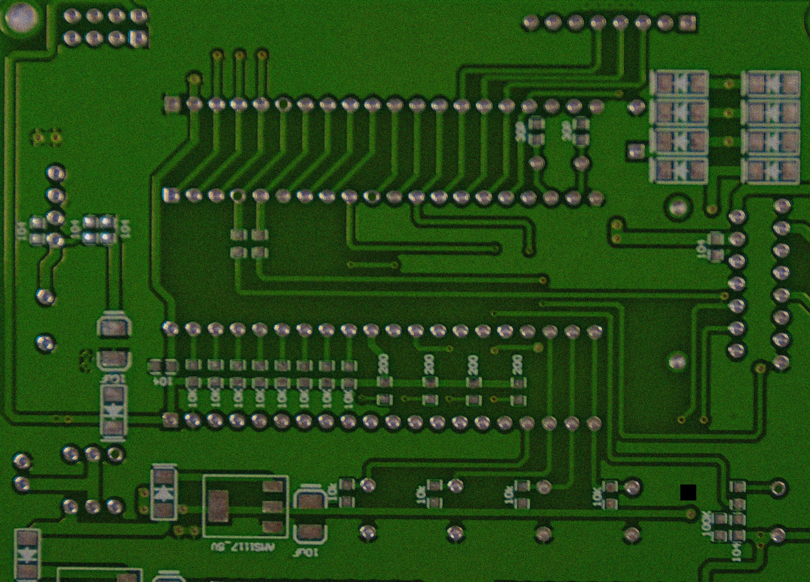<br/><b>Missing hole</b></td>
      <td align="center">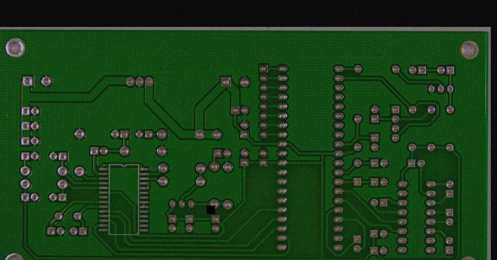<br/><b>Mouse bite</b></td>
      <td align="center">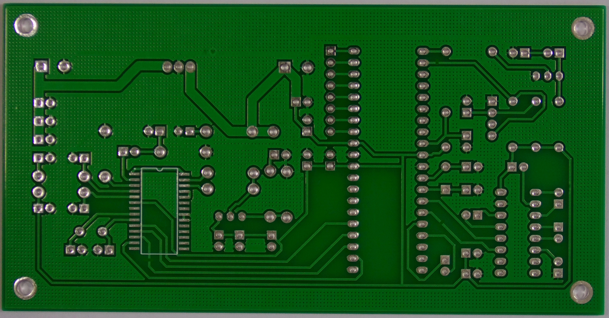<br/><b>Open circuit</b></td>
    </tr>
    <tr>
      <td align="center">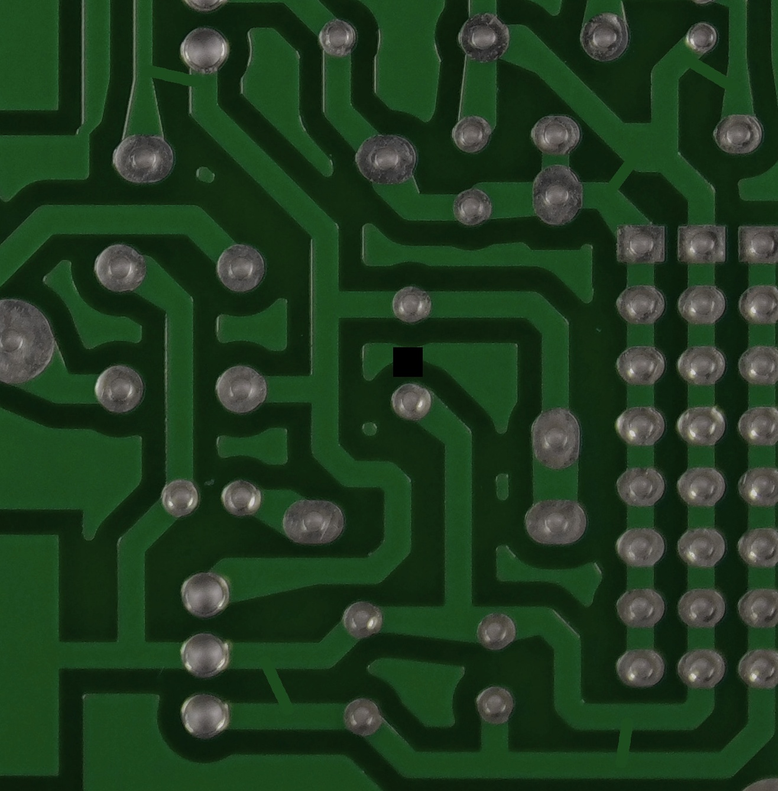<br/><b>Short</b></td>
      <td align="center">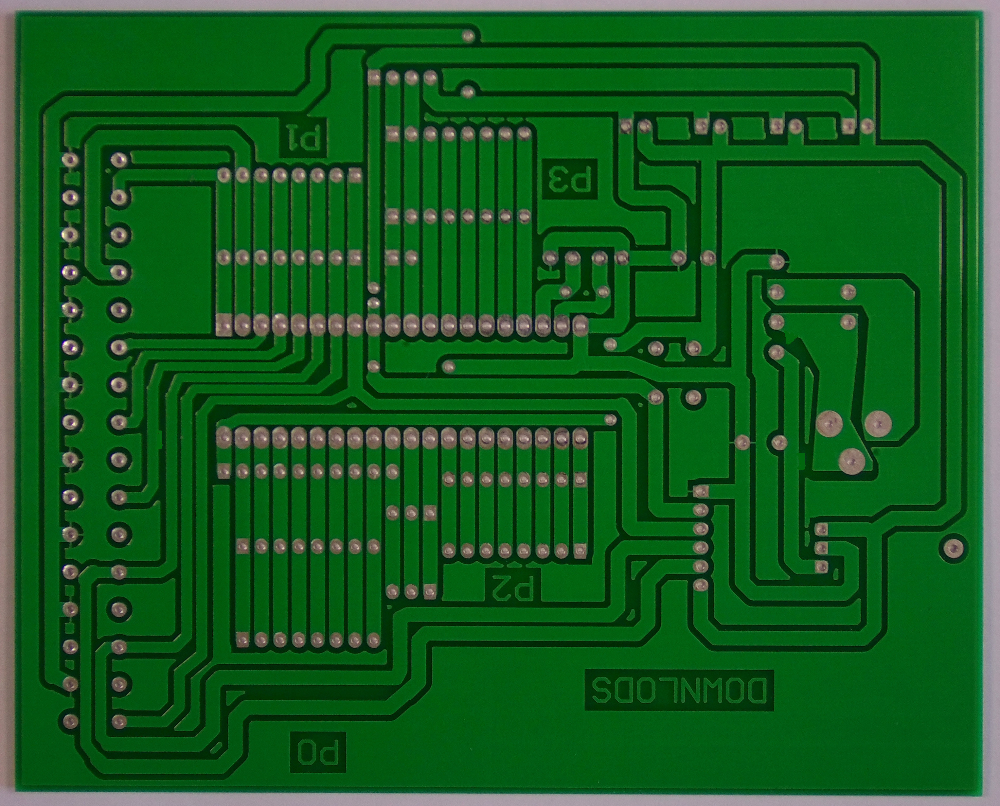<br/><b>Spur</b></td>
      <td align="center">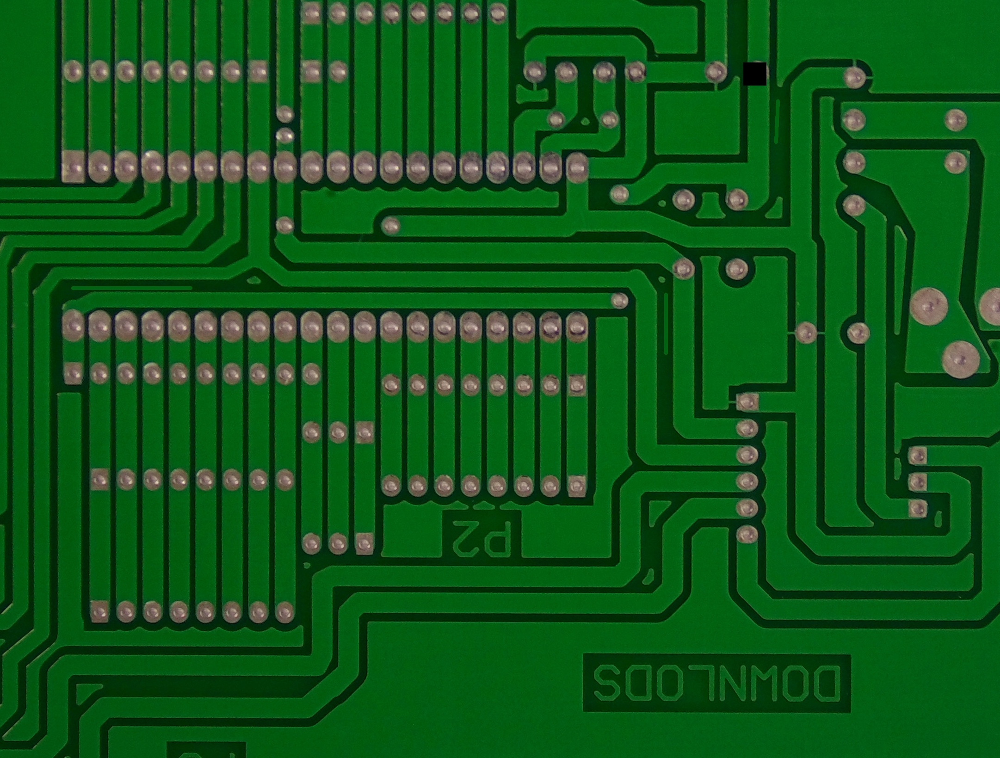<br/><b>Spurious copper</b></td>
    </tr>
  </table>
</div>

## 🧠 Model & Training Configuration

| Parameter | Configuration |
|---|---|
| Detection model | YOLO11n (pretrained checkpoint) |
| Deep-learning framework | PyTorch |
| Model library | Ultralytics |
| Epochs | 5 |
| Input image size | 640 × 640 |
| Batch size | 4 |
| Data-loader workers | 0 |
| Compute | NVIDIA RTX 3050 GPU when CUDA is available; CPU fallback |

The five-epoch run is an initial baseline used to establish a measurable starting point. It is not an extensively tuned training run.

## 📊 Baseline Results

The trained checkpoint was evaluated on the held-out **test split: 366 images and 1,307 annotated defect instances**.

<div align="center">
  <table>
    <tr>
      <td align="center"><h2>80.47%</h2><sub>PRECISION</sub></td>
      <td align="center"><h2>55.22%</h2><sub>RECALL</sub></td>
      <td align="center"><h2>62.16%</h2><sub>mAP@50</sub></td>
      <td align="center"><h2>29.41%</h2><sub>mAP@50–95</sub></td>
    </tr>
  </table>
</div>

| Metric | Test result | Meaning |
|---|---:|---|
| Precision | **80.47%** | Fraction of predicted detections that were correct |
| Recall | **55.22%** | Fraction of ground-truth objects detected |
| mAP@50 | **62.16%** | Mean average precision at IoU 0.50 |
| mAP@50–95 | **29.41%** | Mean average precision across IoU thresholds 0.50–0.95 |

**What these results indicate:** the baseline can identify useful defect patterns, but recall and stricter localization performance need improvement. The metrics are specific to this five-epoch experiment and test split; they are not a guarantee of performance on arbitrary PCB photographs.

### Training progress

<div align="center">
  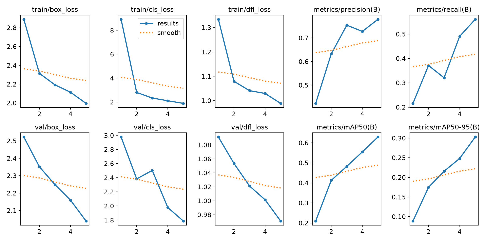
</div>

### Test-set evaluation

<table>
  <tr>
    <td align="center"><b>Confusion Matrix</b><br/>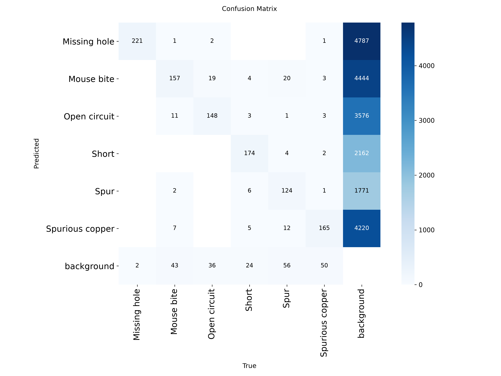</td>
    <td align="center"><b>Normalized Confusion Matrix</b><br/>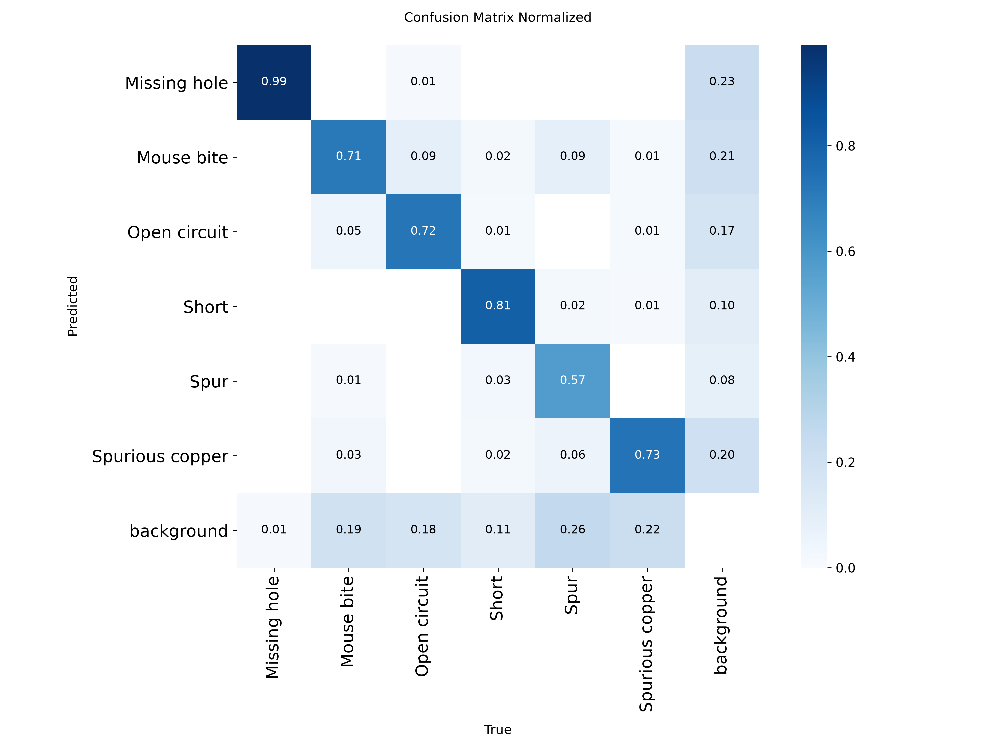</td>
  </tr>
</table>

<div align="center">
  <b>Precision–Recall Curve</b><br/>
  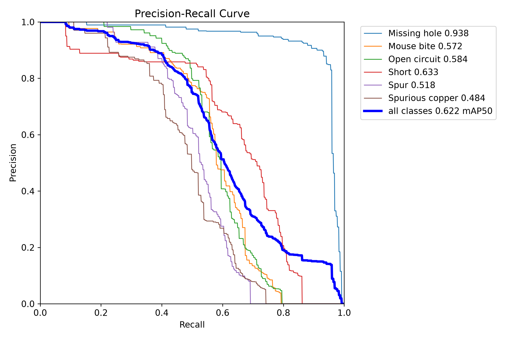
</div>

### Additional test-set metric plots

- [Precision curve](outputs/test_evaluation/BoxP_curve.png)
- [Recall curve](outputs/test_evaluation/BoxR_curve.png)
- [F1-confidence curve](outputs/test_evaluation/BoxF1_curve.png)

## 🖼️ Prediction Showcase

The following are saved model prediction outputs from the Phase 01 experiments. Bounding boxes, class labels, and confidence scores are model predictions; they are not independent confirmation that every marked region is defective.

<div align="center">
  <table>
    <tr>
      <td align="center">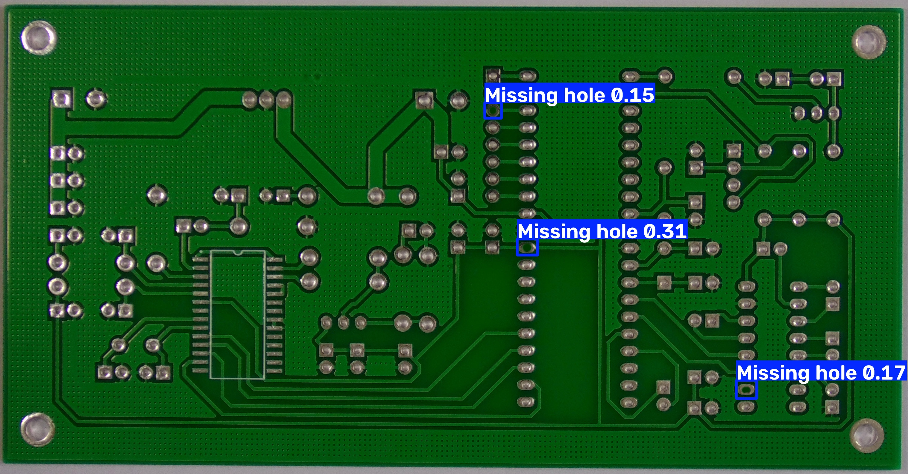<br/><b>PCB defect example</b></td>
      <td align="center">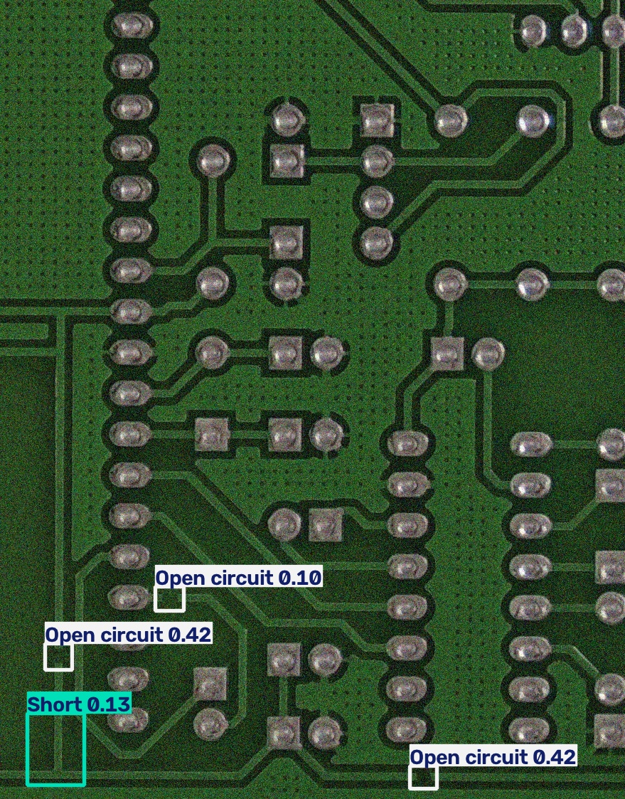<br/><b>Open-circuit example</b></td>
    </tr>
    <tr>
      <td align="center">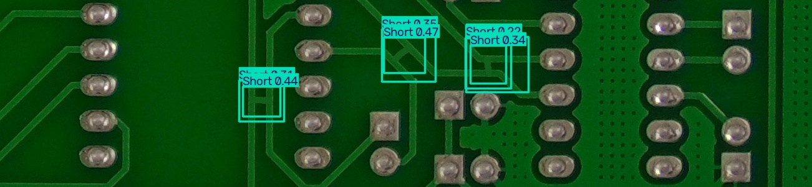<br/><b>Short example</b></td>
      <td align="center">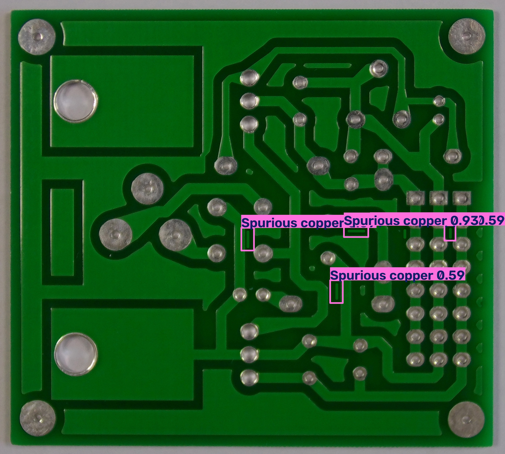<br/><b>Spurious-copper example</b></td>
    </tr>
  </table>
</div>

## 🗂️ Repository Structure

```text
PCB-Vision-Inspector/
│
├── src/
│   ├── check_dataset.py
│   ├── select_dataset_samples.py
│   ├── train.py
│   ├── evaluate.py
│   └── predict.py
│
├── sample_images/                 # Input images for prediction
│
├── outputs/
│   ├── dataset_samples/            # Examples from six dataset classes
│   ├── pcb_baseline/               # Training curves and validation outputs
│   ├── test_evaluation/            # Held-out test metrics and plots
│   └── predictions/                # Annotated prediction examples
│
├── data.yaml                       # YOLO dataset configuration
├── .gitignore
├── LICENSE
└── README.md
```

The full dataset and model checkpoint weights (`.pt`) are intentionally excluded from this repository.

## 🚀 Getting Started

### 1. Clone the repository

```powershell
git clone https://github.com/CodeWithOmsai77/PCB-Vision-Inspector.git
cd PCB-Vision-Inspector
```

### 2. Create a virtual environment

```powershell
python -m venv .venv
.venv\Scripts\Activate.ps1
python -m pip install --upgrade pip
```

### 3. Install dependencies

Install a PyTorch build compatible with your operating system and CUDA setup using the [official PyTorch installation selector](https://pytorch.org/get-started/locally/). Then install the project packages:

```powershell
python -m pip install ultralytics pillow
```

### 4. Download and configure the dataset

Download and extract the PKU-Market-PCB dataset separately. Arrange it as follows:

```text
PKU-Market-PCB/
├── train/
│   ├── images/
│   └── labels/
├── valid/
│   ├── images/
│   └── labels/
└── test/
    ├── images/
    └── labels/
```

Edit the `path` entry in `data.yaml` to point to your local dataset root. The split entries (`train/images`, `valid/images`, and `test/images`) are relative to that root.

**Important:** `src/check_dataset.py` and `src/select_dataset_samples.py` also contain a local `DATASET_PATH` setting. Update it before running either script on another machine.

### 5. Validate the dataset

```powershell
python src/check_dataset.py
```

### 6. Train the baseline model

```powershell
python src/train.py
```

The script loads the pretrained `yolo11n.pt` checkpoint. Ultralytics can download it when it is not already available. Training artifacts and the `best.pt` checkpoint are written to `outputs/pcb_baseline/`.

### 7. Evaluate the held-out test split

```powershell
python src/evaluate.py
```

The evaluation script loads `outputs/pcb_baseline/weights/best.pt`, evaluates the test split, prints precision, recall, mAP@50 and mAP@50–95, and saves plots in `outputs/test_evaluation/`.

### 8. Run prediction

Open `src/predict.py` and set `image_path` to an existing image in `sample_images/`. The currently committed script contains a default sample filename that may need to be changed to match the files in that folder.

```powershell
python src/predict.py
```

The annotated image is saved under `outputs/predictions/`. The current prediction confidence threshold is `0.10`.

## 🛣️ What's Next

### Phase 01 — Baseline model <sub>Completed</sub>

- [x] Dataset preparation and structural annotation validation
- [x] YOLO11n baseline training
- [x] Independent test-set evaluation
- [x] Prediction visualization for PCB defect examples

### Phase 02 — Inspection application <sub>Planned</sub>

- [ ] Build an interactive Streamlit dashboard
- [ ] Add single-image PCB inspection
- [ ] Add batch inspection
- [ ] Store inspection history and analytics
- [ ] Generate downloadable PDF inspection reports
- [ ] Improve recall and reduce false positives through further training and evaluation

## 🧰 Tech Stack

<div align="center">
  
  
  
  
  
  
</div>

## 🙏 Acknowledgements

- **PKU-Market-PCB** dataset and its contributors.
- [Ultralytics](https://github.com/ultralytics/ultralytics) for the YOLO object-detection framework.
- [PyTorch](https://pytorch.org/) for the deep-learning framework.

---

<div align="center">

**PCB Vision Inspector · Phase 01**

*From PCB images to AI-assisted defect detection.*

<sub>Phase 02: Building the interactive inspection application.</sub>

</div>
